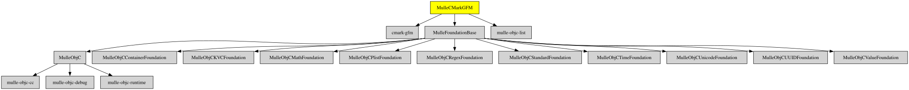

# MulleCMarkGFM

#### 💃🏼 GitHub Flavored Markdown support for mulle-objc


Converts [markdown](https://en.wikipedia.org/wiki/Markdown) to HTML using
[cmark-gfm](https://github.com/github/cmark-gfm), GitHub's CommonMark
implementation with GitHub Flavored Markdown extensions (tables,
strikethrough, autolinks, task lists, footnotes, tagfilter).

MulleCMarkGFM is a drop-in replacement for
[MulleHoedown](//github.com/MulleWeb/MulleHoedown): it offers the same
conversion API and additionally the `cmarkGFM...` methods.


| Release Version                                       | Release Notes  | AI Documentation
|-------------------------------------------------------|----------------|---------------
|  [](//github.com/MulleWeb/MulleCMarkGFM/actions) | [RELEASENOTES](RELEASENOTES.md) | [DeepWiki for MulleCMarkGFM](https://deepwiki.com/MulleWeb/MulleCMarkGFM)


## API

The API shared with MulleHoedown is:

``` objc
- (NSData *) markdownedData;
- (NSData *) markdownedDataWithHTMLFlags:(NSUInteger) flags
                              extensions:(NSUInteger) extensions
                               tocIndent:(NSUInteger) indent;
- (NSString *) markdownedString;
- (NSString *) markdownedStringWithHTMLFlags:(NSUInteger) flags
                                  extensions:(NSUInteger) extensions
                                   tocIndent:(NSUInteger) indent;
```

The method names and flags are shared with MulleHoedown, so source can be moved
between the two; each backend renders with its own native rules, so the output
is not meant to be identical. The flags are the `MULLE_MARKDOWN_HTML_*` and
`MULLE_MARKDOWN_EXT_*` constants.

MulleCMarkGFM additionally offers the `cmarkGFMed...` methods. `markdownedData`
is this backend's native default: it enables cmark-gfm's GitHub Flavored Markdown
extensions (tables, strikethrough, autolinks, task lists, footnotes, tagfilter).
`cmarkGFMed...` are the same methods under a cmark-gfm-specific name.
`hoedownedData` instead reproduces MulleHoedown's default, so existing call
sites keep their behavior.

The MulleHoedown `hoedownedData` / `hoedownedString` methods and the
`HOEDOWN_*` flag constants are provided as well, so existing code keeps
compiling. The `tocIndent` argument is accepted for compatibility and ignored,
cmark-gfm has no table of contents renderer.


### You are here




## Add

Use [mulle-sde](//github.com/mulle-sde) to add MulleCMarkGFM to your project:

``` sh
mulle-sde add github:MulleWeb/MulleCMarkGFM
```

## Install

### Install with mulle-sde

Use [mulle-sde](//github.com/mulle-sde) to build and install MulleCMarkGFM and all dependencies:

``` sh
mulle-sde install --prefix /usr/local \
   https://github.com//MulleCMarkGFM/archive/latest.tar.gz
```

### Manual Installation

Install the requirements:

| Requirements                                 | Description
|----------------------------------------------|-----------------------
| [cmark-gfm](https://github.com/github/cmark-gfm)             | 
| [MulleFoundationBase](https://github.com/MulleFoundation/MulleFoundationBase)             | 🧱 MulleFoundationBase amalgamates Foundations projects
| [mulle-objc-tools](https://github.com/mulle-objc/mulle-objc-tools)             | 📒 Lists mulle-objc runtime information contained in executables.

Download the latest [tar](https://github.com/MulleWeb/MulleCMarkGFM/archive/refs/tags/latest.tar.gz) or [zip](https://github.com/MulleWeb/MulleCMarkGFM/archive/refs/tags/latest.zip) archive and unpack it.

Install **MulleCMarkGFM** into `/usr/local` with [cmake](https://cmake.org):

``` sh
PREFIX_DIR="/usr/local"
cmake -B build                               \
      -DMULLE_SDK_PATH="${PREFIX_DIR}"       \
      -DCMAKE_INSTALL_PREFIX="${PREFIX_DIR}" \
      -DCMAKE_PREFIX_PATH="${PREFIX_DIR}"    \
       -DCMAKE_BUILD_TYPE=Release &&
cmake --build build --config Release &&
cmake --install build --config Release
```

### Platforms and Compilers

All platforms and compilers supported by
[mulle-c11](//github.com/mulle-c/mulle-c11).


## Author

[Nat!](https://mulle-kybernetik.com/weblog) for Mulle kybernetiK  

